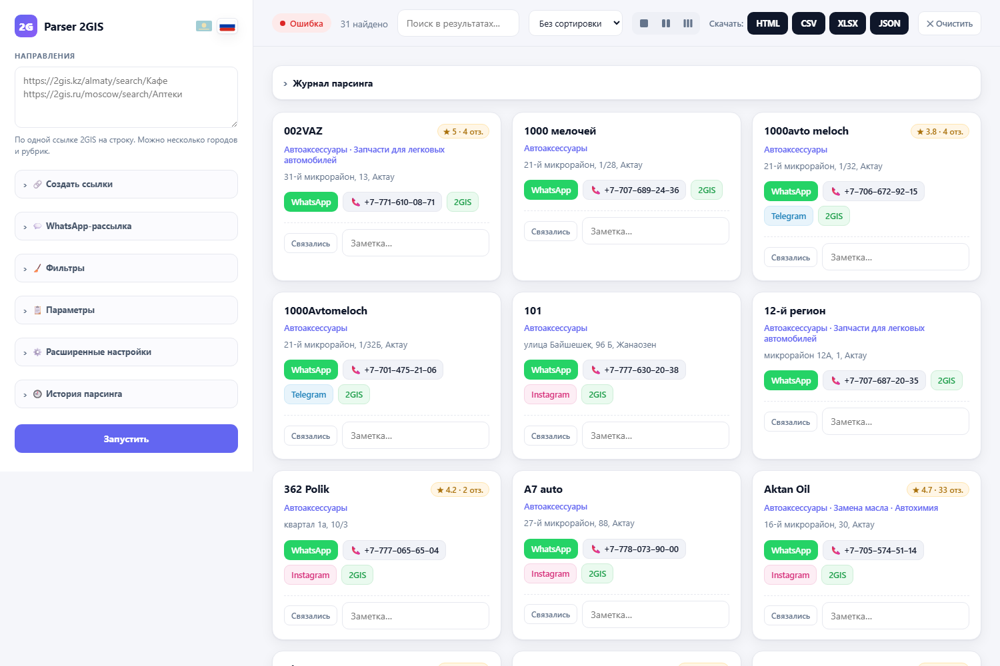

# LeadBombing

Локальное приложение для поиска лидов в [2ГИС](https://2gis.ru/). Управляет Google Chrome на вашем компьютере,
собирает фирмы из выдачи и выгружает их в папку: `leads.json`, `outreach.csv`, `tenants/<slug>/business.json` + фото.
Внешних сервисов нет — только Python, Chrome, 2ГИС и локальный Supabase (аккаунты) в Docker.



## Возможности

- **Сферы:** «Бани и сауны» (только Москва), «Автосервисы», «Салоны красоты», «Стоматологии» и свободный поиск по любому запросу.
- **Несколько городов** за один запуск, лимит фирм на город.
- **Лиды:** выбранные лиды сохраняются в папки аккаунта (новые или существующие) вместе с фото;
  оттуда папку можно выгрузить на диск.
- **Работа с лидом** на странице «Лиды»: цветной статус («Наш клиент», «Ожидаем ответ», «Не ответил», «Слился»)
  напротив каждого лида, приоритет с сортировкой, отметки, по каким контактам связывались, ссылка на
  демо-приложение, комментарий и удаление.
- **Карточка лида** одинакова на поиске и в «Лидах»: «Контакты», «Услуги», «Юрлицо», «Работа с клиентом»; разделы
  сворачиваются по одному или все сразу.
- **Выгрузка с объединением:** если в папке уже есть база той же сферы, новые лиды добавятся, а ручные поля
  «Статус» и «Руководитель» не перезапишутся.
- **Все контакты из карточки 2ГИС** в карточке лида, с подписями как в 2ГИС («Отдел бронирования», «директор»)
  или подписью по умолчанию («для записи»). Номер руководителя выделен и стоит первым при выборе, куда писать.
- **Юрлицо и владелец ИП** в карточке лида.
- **Документация в приложении** (`/docs`): как идёт поиск, кого отсеивает и как выбираются контакты.
- **CLI** для обычного парсинга в CSV / XLSX / JSON / HTML.
- Капча или блокировка 2ГИС останавливает поиск; уже найденное остаётся и выгружается.

## Установка

Нужны Python 3.10+ (в `.venv` используется 3.13), Google Chrome, Docker и Node.js (для `npx supabase`).

```bash
python3 -m venv .venv
```

```bash
.venv/bin/python -m pip install -e .
```

```bash
npx supabase@3.1.0 start
```

```bash
cp .env.example .env.local
```

Впишите в `.env.local` ключ `SUPABASE_ANON_KEY` из вывода `npx supabase@3.1.0 status`.

## Запуск

```bash
.venv/bin/leadbombing
```

Откроется http://localhost:8666. Тестовый вход: `admin` / `admin`. Регистрации нет — пользователей добавляют вручную
(см. `supabase/seed.sql`).

CLI без веб-интерфейса и без Supabase:

```bash
.venv/bin/leadbombing-cli -i "https://2gis.ru/moscow/search/Аптеки" -o out.csv -f csv
```

## Документация

- [docs/LOGIC.md](docs/LOGIC.md) — как работает поиск: отсев фирм, крючок, контакты и выбор канала
- [docs/COMMANDS.md](docs/COMMANDS.md) — команды: запуск, тесты, линтеры, CLI-флаги
- [docs/ENV.md](docs/ENV.md) — переменные окружения
- [docs/STRUCTURE.md](docs/STRUCTURE.md) — структура проекта
- [DESIGN.md](DESIGN.md) и [docs/UX-RULES.md](docs/UX-RULES.md) — дизайн-система и правила интерфейса для новых экранов
- [CHANGELOG.md](CHANGELOG.md) — история изменений

## Лицензия

GNU LGPLv3 (см. [LICENSE](LICENSE) и [THIRD_PARTY_NOTICES.md](THIRD_PARTY_NOTICES.md)).
